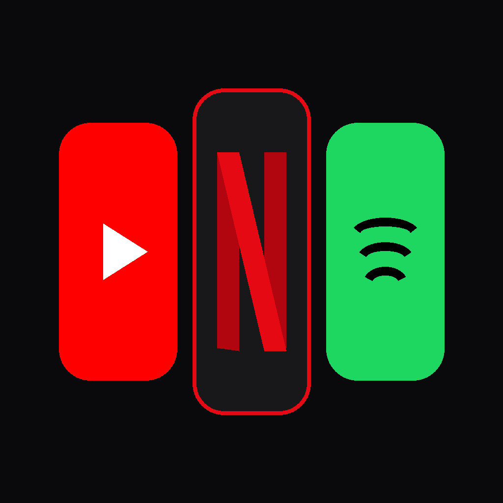
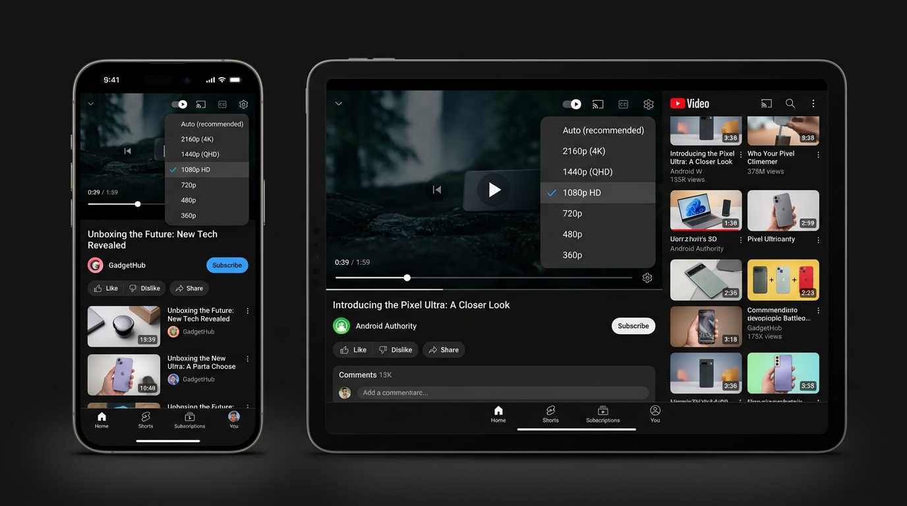

<div align="center">


<br />

# MediaHub & Crossover Suite

**Native iOS (`SwiftUI`) & Android (`Jetpack Compose`) Media Clients — Standalone Apps & All-in-One Crossover Edition**

[](ios/CrossoverApp/README.md)
[](android/MediaHubAndroid/README.md)
[](ios/YouTubeClone/README.md)
[](android/MediaHubAndroid/README.md)
[](android/MediaHubAndroid/README.md)

*Four standalone native media clients and a unified **Crossover** shell — built from scratch for phones and widescreen tablets.*

[Applications](#-applications-at-a-glance) • [Showcase](#-visual-showcase) • [Features](#-key-features) • [Architecture](#-architecture) • [Build Guide](#-building-from-source) • [Upgrade Guides](#-how-to-upgrade--extend)

</div>

---

## Applications at a Glance

<table>
  <tr>
    <td align="center" width="25%">
      <br />
      <strong>YouTube</strong><br />
      <sub>InnerTube + HLS Quality Selector</sub><br /><br />
      <a href="ios/YouTubeClone/README.md">iOS Docs</a> • <a href="android/MediaHubAndroid/README.md">Android Docs</a>
    </td>
    <td align="center" width="25%">
      <br />
      <strong>Netflix</strong><br />
      <sub>TMDB + Movix Cinema Engine</sub><br /><br />
      <a href="ios/NetflixClone/README.md">iOS Docs</a> • <a href="android/MediaHubAndroid/README.md">Android Docs</a>
    </td>
    <td align="center" width="25%">
      <br />
      <strong>Spotify</strong><br />
      <sub>Full-Track Audio + Skyrock Mode</sub><br /><br />
      <a href="ios/SpotifyClone/README.md">iOS Docs</a> • <a href="android/MediaHubAndroid/README.md">Android Docs</a>
    </td>
    <td align="center" width="25%">
      <br />
      <strong>Crossover</strong><br />
      <sub>All-in-One Unified App</sub><br /><br />
      <a href="ios/CrossoverApp/README.md">iOS Docs</a> • <a href="android/MediaHubAndroid/README.md">Android Docs</a>
    </td>
  </tr>
</table>

---

## Visual Showcase

### YouTube — Adaptive Phone & Tablet Player with True Quality Switching
<div align="center">
  
</div>

- **True Resolution Switching (`Auto` → `2160p 4K`)**:
  - **iOS**: Localhost HTTP HLS server (`127.0.0.1`) with `sidx` 5-second fMP4 segment streaming & HLS master playlist pinning (`preferredMaximumResolution` + variant isolation).
  - **Android**: Media3 ExoPlayer `TrackSelectionOverride` on `C.TRACK_TYPE_VIDEO` with automatic progressive fallback and seamless seek preservation.
- **Responsive Layout**: 1-column feed on phones, 2–3 column grid and **2-pane widescreen watch view** on tablets.

---

## Key Features

### YouTube (`YouTubeClone` / `:youtube`)
- **Home, Shorts, Subscriptions & Library** tabs with live InnerTube search and category chips.
- **Quality Selector** (`Auto`, `2160p 4K`, `1440p QHD`, `1080p`, `720p`, `480p`, `360p`, `240p`, `144p`) that applies immediately without losing playback position.
- **TimedText Captions** (`JSON3` / `XML`), playback speed (`0.5x`–`2.0x`), Picture-in-Picture, and offline downloads (iOS).

### Netflix (`NetflixClone` / `:netflix`)
- **Profiles Portal** & dark cinema UI with **widescreen 16:9 Billboard Hero** on tablets.
- **TMDB Discovery**: Top 10, Trending, Genre carousels, and full Season/Episode browser.
- **Fullscreen Player**: Source switcher, speed controls, zoom-to-fill, and offline HLS export (iOS).

### Spotify (`SpotifyClone` / `:spotify`)
- **Full-Track Audio Streaming**: Plays full-length tracks instead of 30-second previews.
- **Artist & Album Pages**: Top tracks, discography, similar artists, and complete `...` track options menu.
- **Skyrock Mode**: Plays the bundled radio jingle with a clean fade-out, followed by a `0.56s` fade-in at `1.025x` varispeed pitch/tempo.

### Crossover (`CrossoverApp` / `:app-crossover`)
- **3 Apps in 1 Binary**: Bundles YouTube, Netflix, and Spotify as modular packages/libraries.
- **Instant App Switcher**: **Long-press the Home tab** from anywhere to switch apps cleanly (auto-pauses previous audio/video streams and remembers your last active app).

---

## Architecture

```text
MediaHub-GitHub/
├── README.md                              # Project homepage
├── .gitignore                             # Excludes .build, .gradle, local.properties, binaries
├── docs/images/                           # Showcase banners & app icons
├── ios/
│   ├── YouTubeClone/                      # Standalone iOS YouTube app (SwiftPM / xtool)
│   ├── NetflixClone/                      # Standalone iOS Netflix app (SwiftPM / xtool)
│   ├── SpotifyClone/                      # Standalone iOS Spotify app (SwiftPM / xtool)
│   └── CrossoverApp/                      # All-in-One iOS Crossover app (3 modular targets)
└── android/
    └── MediaHubAndroid/
        ├── core/                          # Shared OkHttp, ExoVideoSurface, CrossoverBus, adaptive helpers
        ├── youtube/                       # Shared YouTube library (:app-youtube + :app-crossover)
        ├── netflix/                       # Shared Netflix library (:app-netflix + :app-crossover)
        ├── spotify/                       # Shared Spotify library (:app-spotify + :app-crossover)
        ├── app-youtube/                   # Standalone YouTube APK
        ├── app-netflix/                   # Standalone Netflix APK
        ├── app-spotify/                   # Standalone Spotify APK
        └── app-crossover/                 # All-in-One Crossover APK
```

---

## Building from Source

<details>
<summary><strong>iOS Suite (SwiftUI + xtool — works on Linux & macOS)</strong></summary>

1. Install Swift and [`xtool`](https://github.com/xtool-org/xtool).
2. Set your own TMDB API key in `ios/NetflixClone/NetflixClone/Services/NFMovixEngine.swift` and `ios/CrossoverApp/Sources/NetflixModule/Services/NFMovixEngine.swift`.
3. Build any `.ipa`:
   ```bash
   cd ios/YouTubeClone && xtool dev build --ipa
   cd ios/NetflixClone && xtool dev build --ipa
   cd ios/SpotifyClone && xtool dev build --ipa
   cd ios/CrossoverApp && xtool dev build --ipa
   ```
   Output archives are written to `<app>/xtool/<AppName>.ipa`.

</details>

<details>
<summary><strong>Android Suite (Kotlin + Jetpack Compose + Gradle)</strong></summary>

1. Install **JDK 17 or 21**, **Android SDK (`compileSdk = 35`)**, and **Gradle 8.13+**.
2. Create `android/MediaHubAndroid/local.properties`:
   ```properties
   sdk.dir=/path/to/your/android-sdk
   ```
3. Set your TMDB API key in `android/MediaHubAndroid/netflix/src/main/java/com/mediahub/netflix/NetflixEngine.kt`.
4. Build all 4 APKs:
   ```bash
   cd android/MediaHubAndroid
   gradle :app-youtube:assembleDebug :app-netflix:assembleDebug :app-spotify:assembleDebug :app-crossover:assembleDebug
   ```

</details>

---

## How to Upgrade & Extend

Every module has a dedicated developer guide explaining where each feature lives and how to customize or extend it:

| Guide | Covers |
| :--- | :--- |
| [ios/YouTubeClone/README.md](ios/YouTubeClone/README.md) | InnerTube profiles, `YTSequentialStreamServer` HLS engine, quality tiers & UI sheets |
| [ios/NetflixClone/README.md](ios/NetflixClone/README.md) | TMDB endpoints, Movix provider configuration & player controls |
| [ios/SpotifyClone/README.md](ios/SpotifyClone/README.md) | Audio proxy, Skyrock jingle/varispeed tuning & artist/album views |
| [ios/CrossoverApp/README.md](ios/CrossoverApp/README.md) | Module synchronization & adding a 4th app to the Crossover switcher |
| [android/MediaHubAndroid/README.md](android/MediaHubAndroid/README.md) | Multi-module Gradle architecture, ExoPlayer `TrackSelectionOverride` & adaptive layouts |

---

<div align="center">
  <sub>
    Independent personal & educational project created by the repository author. Not affiliated with, endorsed by, sponsored by, or connected to Google LLC / YouTube, Netflix, Inc., or Spotify AB. All trademarks, service marks, and brand names are the property of their respective owners.
  </sub>
</div>
