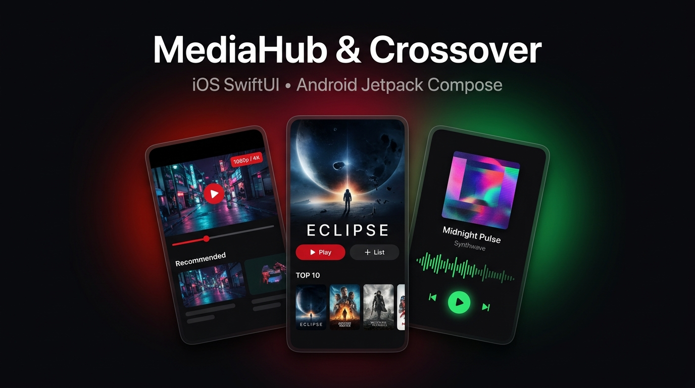

<div align="center">



<br />

# MediaHub & Crossover Suite

**Native iOS (`SwiftUI`) & Android (`Jetpack Compose`) Media Clients — Standalone Apps & All-in-One Crossover Edition**

[](#ios-suite-swiftui--xtool)
[](#android-suite-jetpack-compose--media3)
[](#)
[](#)
[](#)

*Four standalone native media clients and a unified **Crossover** shell — built from scratch for phones and widescreen tablets.*

</div>

---

## Applications at a Glance

<table>
  <tr>
    <td align="center" width="25%">
      <br />
      <strong>YouTube</strong><br />
      <sub>VISIONOS InnerTube + 4K60 HDR + 50s RAM Buffer</sub>
    </td>
    <td align="center" width="25%">
      <br />
      <strong>Netflix</strong><br />
      <sub>TMDB + Movix Cinema Engine</sub>
    </td>
    <td align="center" width="25%">
      <br />
      <strong>Spotify</strong><br />
      <sub>Full-Track Audio + Skyrock Mode</sub>
    </td>
    <td align="center" width="25%">
      <br />
      <strong>Crossover</strong><br />
      <sub>All-in-One Unified App</sub>
    </td>
  </tr>
</table>


---

## Key Features

### YouTube (`ios/YouTubeClone` & `android/MediaHubAndroid/youtube`)
- **Fast `VISIONOS` + `visitorData` InnerTube Engine**: Resolves streams in ~80 ms from `144p` up to `2160p60 4K HDR` and `4320p 8K` with automatic fallback (`TV_SAMSUNG` + `yt-dlp-ejs` / `MWEB` + `BotGuard WebPO` / `ANDROID` / `IOS`).
- **Stutter-Free 50-Second Lookahead Preloading**:
  - **iOS**: Localhost HTTP HLS server (`127.0.0.1`) with 150 MB RAM sliding ring buffer (~50–60 s lookahead), instant `init.mp4` RAM caching, HTTP `206 Partial Content` range support, and full Apple HLS HDR signaling (`VIDEO-RANGE=PQ`, `CODECS`, `FRAME-RATE`) with automatic native HLS HDR fallback.
  - **Android**: Media3 ExoPlayer with `DefaultLoadControl` (45–90 s forward buffer, 1.2 s fast start) and `TrackSelectionOverride` quality switching.
- **Screen-Awake Playback**: Keeps the screen on during active video playback (fullscreen, portrait, Shorts) and restores normal auto-lock on pause/close/background.
- **TimedText Captions** (`JSON3` / `XML`), playback speed (`0.5x`–`2.0x`), Picture-in-Picture, and offline downloads (iOS).

### Netflix (`ios/NetflixClone` & `android/MediaHubAndroid/netflix`)
- **TMDB Discovery**: Top 10, Trending, Genre carousels, and full Season/Episode browser.
- **Fullscreen Player**: Source switcher, speed controls, zoom-to-fill, 45–90 s forward buffering, and screen-awake playback.
- **Configuration**: Replace `YOUR_TMDB_API_KEY` in `NFMovixEngine.swift` / `NetflixEngine.kt` with your own TMDB v3 API key before building.

### Spotify (`ios/SpotifyClone` & `android/MediaHubAndroid/spotify`)
- **Full-Track Audio Streaming** with background audio, Lock Screen / Control Center metadata, and **Skyrock Mode**.
- **Artist & Album Pages**: Top tracks, discography, playlists, and library management.

### Crossover (`ios/CrossoverApp` & `android/MediaHubAndroid/app-crossover`)
- Combines **YouTube**, **Netflix**, and **Spotify** into a single unified native app with instant switching (long-press Home tab).

---

## Repository Structure

```text
MediaHub/
├── ios/
│   ├── YouTubeClone/          # Standalone iOS YouTube app (SwiftUI + xtool)
│   ├── NetflixClone/          # Standalone iOS Netflix app (SwiftUI + xtool)
│   ├── SpotifyClone/          # Standalone iOS Spotify app (SwiftUI + xtool)
│   └── CrossoverApp/          # All-in-One iOS Crossover app (SwiftUI + xtool)
├── android/
│   └── MediaHubAndroid/       # Multi-module Gradle project (YouTube, Netflix, Spotify, Crossover APKs)
└── docs/
    └── images/                # Banners, UI showcase, and app icons
```

---

## Building from Source

### iOS Suite (`SwiftUI` + `xtool`)
```bash
cd ios/YouTubeClone && xtool dev build --ipa
cd ios/NetflixClone && xtool dev build --ipa
cd ios/SpotifyClone && xtool dev build --ipa
cd ios/CrossoverApp && xtool dev build --ipa
```

### Android Suite (`Jetpack Compose` + `Media3`)
```bash
cd android/MediaHubAndroid
gradle :app-youtube:assembleDebug :app-netflix:assembleDebug :app-spotify:assembleDebug :app-crossover:assembleDebug
```
